<div align="center">

<h1>kiban</h1>

<strong>Docker とプロジェクトに必要なローカルデータベースを最高速度で動かします。Mac ではネイティブな Colima VM で、Linux では VM なしで。</strong>

[English](README.md) | 日本語 | [简体中文](README.zh-Hans.md) | [繁體中文 (香港)](README.zh-HK.md)

[](https://github.com/gufranco/kiban/actions/workflows/ci.yml)
[](https://github.com/gufranco/kiban/releases/latest)
[](LICENSE)

<p align="center">
  <a href="#quick-start"><strong>クイックスタート</strong></a> |
  <a href="#settings">設定</a> |
  <a href="#development">開発</a>
</p>

</div>

コマンドは 1 つ、サービスは 6 つ、すべての値は環境変数で変えられます。`kiban` は日本語の「基盤」です。

---

<p align="center">
  
</p>

```console
$ kiban status
service    state      address           image
mongo      absent     127.0.0.1:27017   mongo:8
postgres   absent     127.0.0.1:5432    postgres:18-alpine
redis      absent     127.0.0.1:6379    redis:8-alpine
valkey     absent     127.0.0.1:7000    valkey/valkey:8-alpine
redict     absent     127.0.0.1:6380    registry.redict.io/redict:7-alpine
ubuntu     absent     -                 ubuntu:26.04
```

<a id="quick-start"></a>

## クイックスタート

### 前提条件

| ツール | 用途 | インストール |
|:-------|:-----|:-------------|
| [`gum`](https://github.com/charmbracelet/gum) | 端末の画面：メニュー、入力、表、配色 | `brew install gum`。Homebrewのformulaが自動でインストールします |
| POSIX `sh`、`awk`、`sed` | ツール本体 | macOS と Linux に標準で入っています。`bash` は不要です |
| `docker` | Docker CLI | `brew install docker`、Linux では Docker の apt リポジトリの Docker Engine |
| `colima` | Mac の VM | `brew install colima` |
| `systemctl`、`sudo` | Linux でエンジンを起動・停止します | Ubuntu に標準で入っています |
| `fzf` | 任意。gum が描けない場所でコンテナを選びます。ない場合は番号付きメニューになります | `brew install fzf`、`apt install fzf` |

### インストール

```bash
brew install gufranco/tap/kiban
```

ソースからもインストールできます。

```bash
git clone https://github.com/gufranco/kiban.git
cd kiban
make install
```

`make install` はツール、man ページ、bash・zsh・fish の補完を `~/.local` にコピーし、`kiban` を `~/.local/bin` に置きます。場所を変えるには `PREFIX` を指定します。Homebrew の formula も同じファイルをインストールします。

### 確認

```console
$ kiban doctor
gum                ok       /opt/homebrew/bin/gum
docker             ok       /opt/homebrew/bin/docker
awk                ok       /opt/homebrew/opt/gawk/libexec/gnubin/awk, gnu 5.4.1
sed                ok       /opt/homebrew/opt/gnu-sed/libexec/gnubin/sed, gnu 4.10
colima             ok       /opt/homebrew/bin/colima
rosetta            ok       runs x86_64 images in the VM
fzf                ok       /opt/homebrew/bin/fzf
```

## 使い方

| コマンド | 目的 |
|:---------|:-----|
| `kiban start [profile]` | Docker を起動します。Mac では Colima VM、Linux ではエンジンそのもの |
| `kiban stop [profile]` | 停止します |
| `kiban up <service>...` | mongo、postgres、redis、valkey、redict、ubuntu を初回は作成し、以後は起動します |
| `kiban down [container]...` | コンテナを停止します。名前がなければ動作中のものから選びます |
| `kiban shell [container]`、`kiban logs [container]` | コンテナでシェルを開く、またはログを追います |
| `kiban status` | すべてのサービスの状態、アドレス、イメージを表示します |
| `kiban reset <service>` | サービスのコンテナ、ボリューム、データフォルダを削除します |
| `kiban prune [profile]`、`kiban purge [profile]` | すべてのコンテナ、イメージ、ボリューム、ビルドキャッシュを削除します。`purge` は VM も削除します |
| `kiban config` | すべての設定と、その値の出どころを表示します |
| 引数なしの `kiban` | ターミナルではメニューを表示します。gum のリストで、gum がなければ番号付きです |
| `kiban doctor`、`kiban version`、`kiban help` | ツールの確認、バージョン、使い方を表示します |

`reset`、`prune`、`purge` は、サービス名またはプロファイル名を入力し直すまで何も変えません。

```bash
kiban start                          # この Mac に合わせた VM
kiban up postgres redis              # 127.0.0.1:5432 と :6379 で両方
KIBAN_POSTGRES_PORT=5433 kiban up postgres
kiban --cpus 4 --memory 8 start work # work という 2 つ目の VM
```

kiban はファミリー共通のコマンドライン規約に従います。内容は [FAMILY.md](FAMILY.md) にあります。

### テーマ

`gum`がインストールされた端末では、kibanはメニュー、入力、表、メッセージをgumで描きます。パイプやスクリプトでは、出力はプレーンテキストのままです。配色は`--theme`、なければ`KIBAN_THEME`、なければ`KODOUGU_THEME`で選びます。最後のものはkodouguのすべてのツールが共有します：`kodougu` （既定）、`catppuccin-mocha`、`catppuccin-latte`、`dracula`、`nord`、`gruvbox`、`tokyo-night`、`mono`。`KODOUGU_ACCENT=#RRGGBB`はアクセント色だけを置き換え、`NO_COLOR`は色を消します。

```bash
export KODOUGU_THEME=catppuccin-mocha
```

<a id="settings"></a>

## 設定

kiban が使うすべての値には既定値と `KIBAN_` 変数があり、コマンドラインのオプションが変数より優先されます。`kiban config` は各設定、その値、出どころを一覧にします。

```console
$ kiban config
setting                  value                                from
KIBAN_PROFILE            default                              default
KIBAN_CPUS               4                                    default
KIBAN_MEMORY             8                                    default
KIBAN_DISK               64                                   default
KIBAN_VM_TYPE            vz                                   default
KIBAN_ARCH               aarch64                              default
KIBAN_ROSETTA            y                                    default
KIBAN_MOUNT_TYPE         virtiofs                             default
KIBAN_MOUNT_INOTIFY      n                                    default
KIBAN_DNS                -                                    default
KIBAN_DATA_DIR           /Users/gufranco/Docker               default
```

| 設定 | 既定値 |
|:-----|:-------|
| `KIBAN_CPUS`、`KIBAN_MEMORY`、`KIBAN_DISK` | コアの半分で 2 から 4、メモリの半分で 2 から 8 GiB、ディスクの 4 分の 1 で 8 から 64 GiB |
| `KIBAN_ARCH`、`KIBAN_ROSETTA` | マシン自身のアーキテクチャ。Apple Silicon では Rosetta |
| `KIBAN_VM_TYPE`、`KIBAN_MOUNT_TYPE`、`KIBAN_MOUNT_INOTIFY` | `vz`、`virtiofs`、`n` |
| `KIBAN_DNS`、`KIBAN_DATA_DIR`、`KIBAN_PROFILE` | ホストのリゾルバ、`~/Docker`、`default` |
| `KIBAN_<SERVICE>_IMAGE` | `mongo:8`、`postgres:18-alpine`、`redis:8-alpine`、`valkey/valkey:8-alpine`、`registry.redict.io/redict:7-alpine`、`ubuntu:26.04` |
| `KIBAN_<SERVICE>_PORT` | mongo 27017、postgres 5432、redis 6379、valkey 7000、redict 6380 |
| `KIBAN_MONGO_USER`、`KIBAN_MONGO_PASSWORD`、`KIBAN_POSTGRES_USER`、`KIBAN_POSTGRES_PASSWORD` | `mongo`、`mongo`、`postgres`、`postgres` |
| `KIBAN_THEME`、`--theme` | `KODOUGU_THEME`、なければ `kodougu`。テーマの節を参照 |
| `KIBAN_POSTGRES_SHM`、`KIBAN_<SERVICE>_MAXMEMORY` | `1g`。redis、valkey、redict は `256mb` |

<a id="speed"></a>

## 速度

| マシン | kiban の動作 |
|:-------|:-------------|
| Mac、Apple Silicon | Apple の Virtualization フレームワークと virtiofs によるネイティブな aarch64 VM、x86_64 イメージには Rosetta。ハードウェアを読むので、Rosetta で動くターミナルからでもネイティブな VM になります |
| Mac、Intel | 同じフレームワークと virtiofs による x86_64 VM |
| Linux、x86_64 または arm64 | VM なし。Docker はマシン上で直接動きます |

既定のイメージはすべて amd64 と arm64 のビルドがあるので、上のどのマシンでもエミュレーションなしで動きます。ホームフォルダの変更をすべて VM に送ると CPU を使うため、`--mount-inotify` を指定しない限りファイルイベントは VM に送りません。postgres には Docker の 64 MiB ではなく 1 GiB の共有メモリを与えます。64 MiB では並列クエリが制限されるからです。kiban 自身は追加のプロセスなしですべての設定を解決するので、`kiban config` は約 0.1 秒で答えます。

<a id="portability"></a>

## 移植性

すべて POSIX `sh` で書かれ、ShellCheck `-o all` の指摘はゼロです。テストは macOS では `/bin/sh` と `dash`、システムの bash 3.2 と zsh、Homebrew の最新の bash と zsh で、Ubuntu ではコンテナ内の `dash`、`bash`、`bash --posix`、`zsh` で実行します。CI はファミリーの 6 つのツールセットで繰り返し、`kiban doctor` は `awk` と `sed` の種類とバージョンを示します。

<a id="screens"></a>

## 画面

<details>
<summary><code>make screens</code> で実際の実行から録画したすべての画面</summary>
<br>

<table>
<tr>
<td width="50%" valign="top">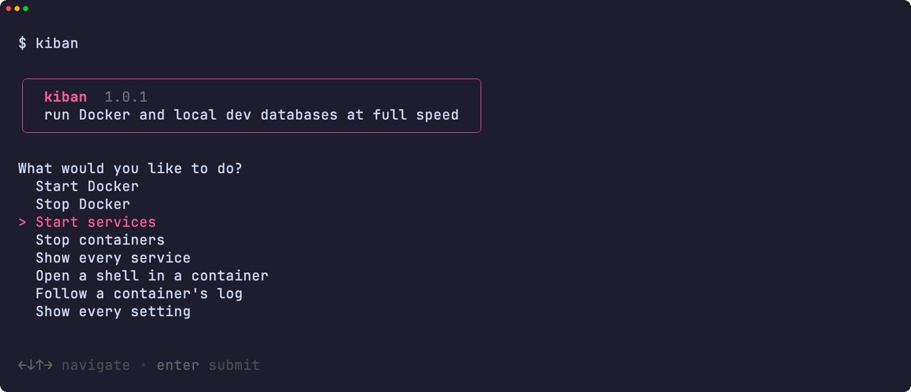<br><sub>メニュー</sub></td>
<td width="50%" valign="top">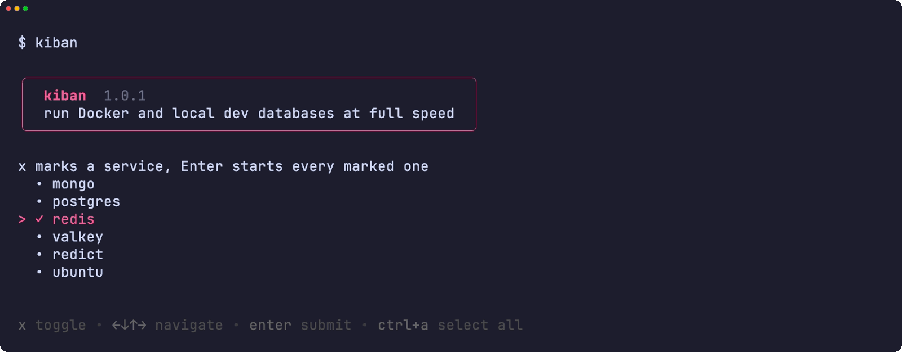<br><sub>起動するサービスの選択</sub></td>
</tr>
<tr>
<td width="50%" valign="top">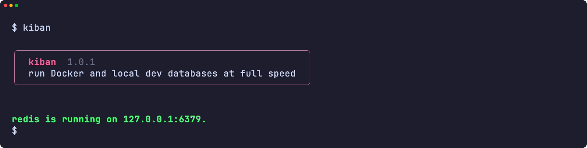<br><sub>起動したサービス</sub></td>
<td width="50%" valign="top">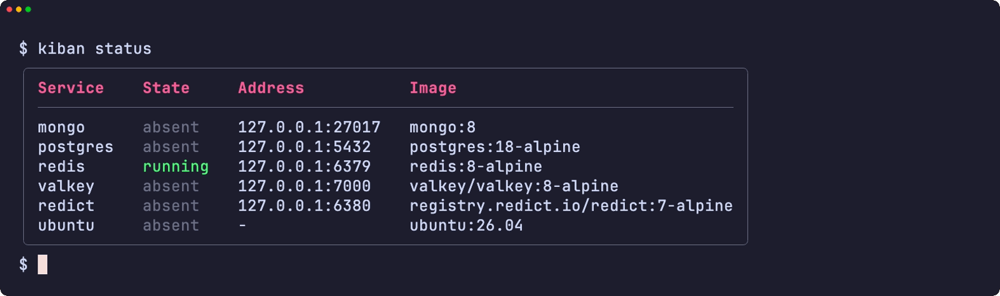<br><sub>すべてのサービスとそのアドレス</sub></td>
</tr>
<tr>
<td width="50%" valign="top">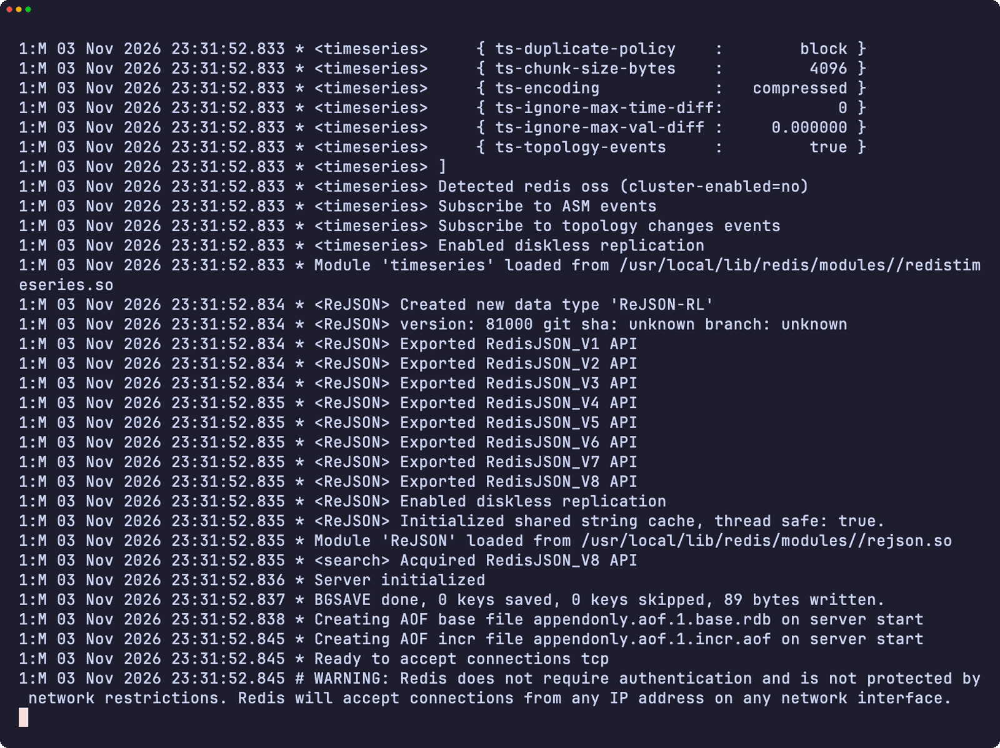<br><sub>コンテナのログ</sub></td>
<td width="50%" valign="top">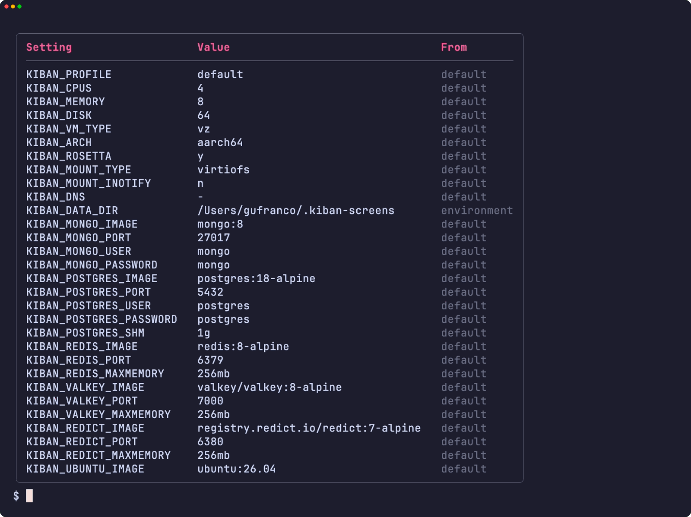<br><sub>すべての設定とその出所</sub></td>
</tr>
<tr>
<td width="50%" valign="top">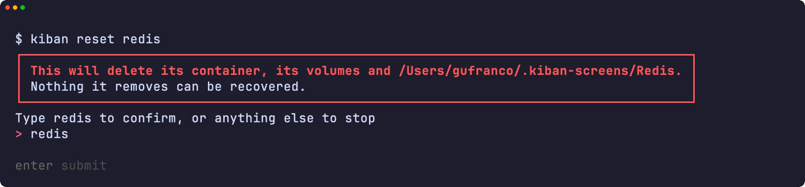<br><sub>危険ボックスの下での名前の入力</sub></td>
<td width="50%" valign="top">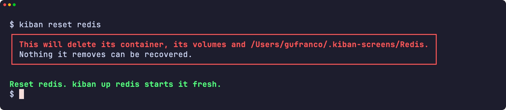<br><sub>リセットしたサービス</sub></td>
</tr>
<tr>
<td width="50%" valign="top">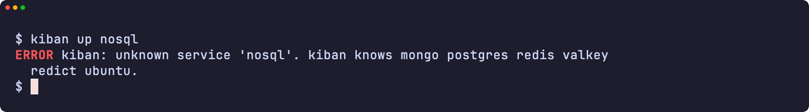<br><sub>エラー</sub></td>
<td width="50%" valign="top">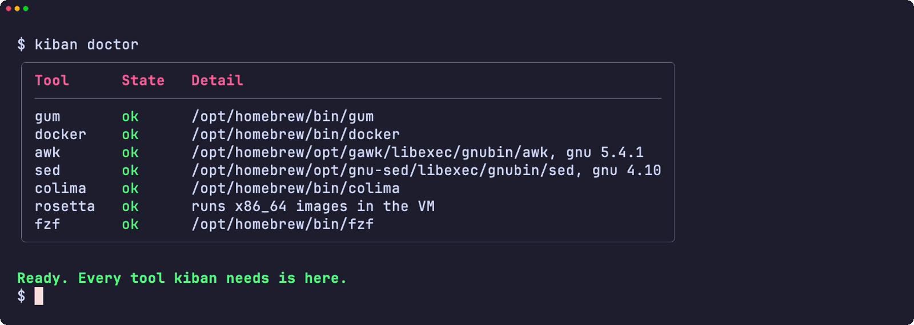<br><sub>doctor が必要なツールをすべて確認</sub></td>
</tr>
<tr>
<td width="50%" valign="top">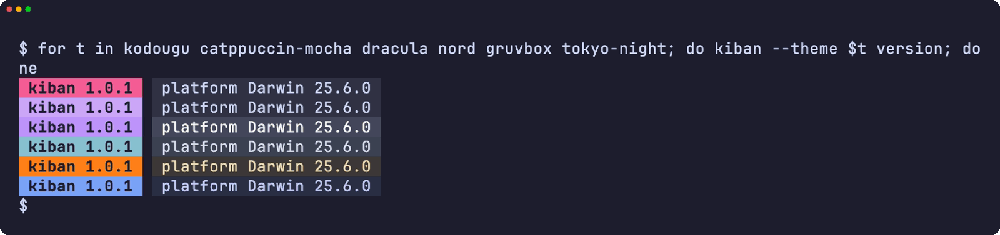<br><sub>6 つのテーマでのバージョン表示</sub></td>
<td width="50%" valign="top">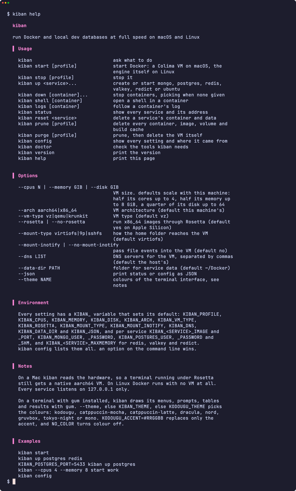<br><sub>ヘルプ</sub></td>
</tr>
</table>

</details>

<a id="development"></a>

## 開発

| コマンド | 説明 |
|:---------|:-----|
| `make fmt` | すべてのスクリプトを shfmt で整形します |
| `make lint` | shfmt、すべてのスクリプト・テスト・補完への ShellCheck、名前の検査、man ページへの mandoc |
| `make test` | システムの `sh` で `bats` テストを実行します |
| `make test-all` | すべてのシェルで同じテストを実行します。macOS では bash と zsh の両方のビルドを含みます |
| `make test-linux` | Ubuntu コンテナで同じテストを実行します |
| `make coverage` | この Mac と Ubuntu コンテナでの bashcov 行カバレッジを統合し、CI と同じ 100% のゲートをかけます |
| `make screens` | macOS で、README の画面を実物のツールから VHS で録画します |

CI のランナーは Colima を起動できないため、テストは偽の `docker`、`colima`、`systemctl` とホストのツールを `PATH` に置き、kiban のすべての呼び出しを確かめます。`main` への push で CI が通ると semantic-release が動き、`feat` か `fix` のコミットがリリースを公開して、[`lib/core.sh`](lib/core.sh) の `KIBAN_VERSION` と CHANGELOG を更新し、Homebrew の formula を上げます。

## ライセンス

[MIT](LICENSE)
