<div align="center">

<h1>kiban</h1>

<strong>以最快速度運行 Docker 及項目所需的本機數據庫：在 Mac 上用原生 Colima 虛擬機，在 Linux 上完全不用虛擬機。</strong>

[English](README.md) | [日本語](README.ja.md) | [简体中文](README.zh-Hans.md) | 繁體中文 (香港)

[](https://github.com/gufranco/kiban/actions/workflows/ci.yml)
[](https://github.com/gufranco/kiban/releases/latest)
[](LICENSE)

<p align="center">
  <a href="#quick-start"><strong>快速開始</strong></a> |
  <a href="#settings">設定</a> |
  <a href="#development">開發</a>
</p>

</div>

一個指令，六項服務，每個值都可以用環境變數覆寫。`kiban` 是日語的「基盤」，意思是基礎。

---

<p align="center">
  
</p>

```console
$ kiban status
service    state      address           image
mongo      absent     127.0.0.1:27017   mongo:8
postgres   absent     127.0.0.1:5432    postgres:18-alpine
redis      absent     127.0.0.1:6379    redis:8-alpine
valkey     absent     127.0.0.1:7000    valkey/valkey:8-alpine
redict     absent     127.0.0.1:6380    registry.redict.io/redict:7-alpine
ubuntu     absent     -                 ubuntu:26.04
```

<a id="quick-start"></a>

## 快速開始

### 先決條件

| 工具 | 用途 | 安裝 |
|:-----|:-----|:-----|
| [`gum`](https://github.com/charmbracelet/gum) | 終端介面：選單、輸入、表格及配色 | `brew install gum`。Homebrew formula 會自動安裝 |
| POSIX `sh`、`awk`、`sed` | 工具本身 | macOS 和 Linux 已預載。毋須 `bash` |
| `docker` | Docker CLI | `brew install docker`；Linux 上用 Docker apt 軟件庫中的 Docker Engine |
| `colima` | Mac 上的虛擬機 | `brew install colima` |
| `systemctl`、`sudo` | 在 Linux 上啟動和停止引擎 | Ubuntu 已預載 |
| `fzf` | 可選：在 gum 無法繪製時揀選容器；沒有的話 kiban 改用編號選單 | `brew install fzf`；`apt install fzf` |

### 安裝

```bash
brew install gufranco/tap/kiban
```

亦可從原始碼安裝：

```bash
git clone https://github.com/gufranco/kiban.git
cd kiban
make install
```

`make install` 會把工具、man 說明頁，以及 bash、zsh 和 fish 的自動完成複製到 `~/.local`，並把 `kiban` 放進 `~/.local/bin`；設定 `PREFIX` 可更改位置。Homebrew formula 會安裝同樣的檔案。

### 驗證

```console
$ kiban doctor
gum                ok       /opt/homebrew/bin/gum
docker             ok       /opt/homebrew/bin/docker
awk                ok       /opt/homebrew/opt/gawk/libexec/gnubin/awk, gnu 5.4.1
sed                ok       /opt/homebrew/opt/gnu-sed/libexec/gnubin/sed, gnu 4.10
colima             ok       /opt/homebrew/bin/colima
rosetta            ok       runs x86_64 images in the VM
fzf                ok       /opt/homebrew/bin/fzf
```

## 用法

| 指令 | 用途 |
|:-----|:-----|
| `kiban start [profile]` | 啟動 Docker：Mac 上是 Colima 虛擬機，Linux 上是引擎本身 |
| `kiban stop [profile]` | 停止它 |
| `kiban up <service>...` | 首次建立 mongo、postgres、redis、valkey、redict 或 ubuntu，之後則啟動它 |
| `kiban down [container]...` | 停止容器；不指定名稱時從正在運行的容器中揀選 |
| `kiban shell [container]`、`kiban logs [container]` | 在容器中開啟 shell，或追蹤其記錄 |
| `kiban status` | 顯示每項服務的狀態、地址和映像 |
| `kiban reset <service>` | 刪除服務的容器、卷宗和數據資料夾 |
| `kiban prune [profile]`、`kiban purge [profile]` | 刪除所有容器、映像、卷宗和建置快取；`purge` 亦會刪除虛擬機 |
| `kiban config` | 顯示每項設定及其來源 |
| 不帶參數的 `kiban` | 在終端機中執行時顯示選單：gum 列表，沒有 gum 時為編號選單 |
| `kiban doctor`、`kiban version`、`kiban help` | 檢查工具、顯示版本、顯示用法說明 |

在再次輸入服務或配置名稱之前，`reset`、`prune` 和 `purge` 不會作任何改動。

```bash
kiban start                          # 按這部 Mac 調整大小的虛擬機
kiban up postgres redis              # 兩者，分別在 127.0.0.1:5432 和 :6379
KIBAN_POSTGRES_PORT=5433 kiban up postgres
kiban --cpus 4 --memory 8 start work # 名為 work 的第二部虛擬機
```

kiban 遵從家族共用的指令行約定，內容見 [FAMILY.md](FAMILY.md)。

### 主題

在裝有 `gum` 的終端機上，kiban 用 gum 繪製選單、輸入、表格及訊息；在管道或指令碼中，輸出仍是純文字。配色依次由 `--theme`、`KIBAN_THEME`、`KODOUGU_THEME` 決定，最後一個由所有 kodougu 工具共用：`kodougu`（預設）、`catppuccin-mocha`、`catppuccin-latte`、`dracula`、`nord`、`gruvbox`、`tokyo-night` 或 `mono`。`KODOUGU_ACCENT=#RRGGBB` 只取代強調色，`NO_COLOR` 關閉顏色。

```bash
export KODOUGU_THEME=catppuccin-mocha
```

<a id="settings"></a>

## 設定

kiban 使用的每個值都有預設值和相應的 `KIBAN_` 變數；指令行上的選項優先於變數。`kiban config` 列出每項設定、它的值和來源：

```console
$ kiban config
setting                  value                                from
KIBAN_PROFILE            default                              default
KIBAN_CPUS               4                                    default
KIBAN_MEMORY             8                                    default
KIBAN_DISK               64                                   default
KIBAN_VM_TYPE            vz                                   default
KIBAN_ARCH               aarch64                              default
KIBAN_ROSETTA            y                                    default
KIBAN_MOUNT_TYPE         virtiofs                             default
KIBAN_MOUNT_INOTIFY      n                                    default
KIBAN_DNS                -                                    default
KIBAN_DATA_DIR           /Users/gufranco/Docker               default
```

| 設定 | 預設值 |
|:-----|:-------|
| `KIBAN_CPUS`、`KIBAN_MEMORY`、`KIBAN_DISK` | 一半的核心，介乎 2 至 4；一半的記憶體，介乎 2 至 8 GiB；四分之一的磁碟，介乎 8 至 64 GiB |
| `KIBAN_ARCH`、`KIBAN_ROSETTA` | 機器本身的架構；Apple Silicon 上啟用 Rosetta |
| `KIBAN_VM_TYPE`、`KIBAN_MOUNT_TYPE`、`KIBAN_MOUNT_INOTIFY` | `vz`、`virtiofs`、`n` |
| `KIBAN_DNS`、`KIBAN_DATA_DIR`、`KIBAN_PROFILE` | 主機的解析器、`~/Docker`、`default` |
| `KIBAN_<SERVICE>_IMAGE` | `mongo:8`、`postgres:18-alpine`、`redis:8-alpine`、`valkey/valkey:8-alpine`、`registry.redict.io/redict:7-alpine`、`ubuntu:26.04` |
| `KIBAN_<SERVICE>_PORT` | mongo 27017、postgres 5432、redis 6379、valkey 7000、redict 6380 |
| `KIBAN_MONGO_USER`、`KIBAN_MONGO_PASSWORD`、`KIBAN_POSTGRES_USER`、`KIBAN_POSTGRES_PASSWORD` | `mongo`、`mongo`、`postgres`、`postgres` |
| `KIBAN_THEME`、`--theme` | `KODOUGU_THEME`，否則 `kodougu`；見主題一節 |
| `KIBAN_POSTGRES_SHM`、`KIBAN_<SERVICE>_MAXMEMORY` | `1g`；redis、valkey 和 redict 為 `256mb` |

<a id="speed"></a>

## 速度

| 機器 | kiban 的做法 |
|:-----|:-------------|
| Mac，Apple Silicon | 基於 Apple Virtualization 框架和 virtiofs 的原生 aarch64 虛擬機，x86_64 映像經 Rosetta 運行。它讀取硬件資料，所以即使終端機在 Rosetta 下運行，仍然得到原生虛擬機 |
| Mac，Intel | 基於同一框架和 virtiofs 的 x86_64 虛擬機 |
| Linux，x86_64 或 arm64 | 沒有虛擬機：Docker 直接在本機運行 |

所有預設映像都有 amd64 和 arm64 版本，所以在上述每種機器上服務都毋須模擬。除非以 `--mount-inotify` 要求，檔案事件不會傳入虛擬機，因為轉送主資料夾中的每次變動都會耗用 CPU。postgres 獲得 1 GiB 共用記憶體，而非 Docker 預設的 64 MiB，後者會限制並行查詢。kiban 本身解析所有設定時不會啟動額外程序，所以 `kiban config` 約十分之一秒便有結果。

<a id="portability"></a>

## 可攜性

全部以 POSIX `sh` 編寫，ShellCheck `-o all` 零警告。測試在 macOS 上於 `/bin/sh` 和 `dash`、系統內置的 bash 3.2 和 zsh、Homebrew 最新的 bash 和 zsh 下執行，在 Ubuntu 上於容器內的 `dash`、`bash`、`bash --posix` 和 `zsh` 下執行。CI 會在家族的六種工具組合上重複這些測試，`kiban doctor` 會列出 `awk` 和 `sed` 的種類與版本。

<a id="screens"></a>

## 畫面

<details>
<summary>全部畫面，均由 <code>make screens</code> 錄自真實執行</summary>
<br>

<table>
<tr>
<td width="50%" valign="top">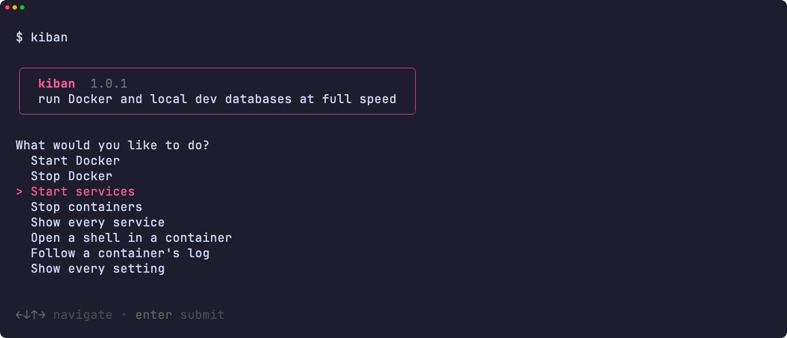<br><sub>選單</sub></td>
<td width="50%" valign="top">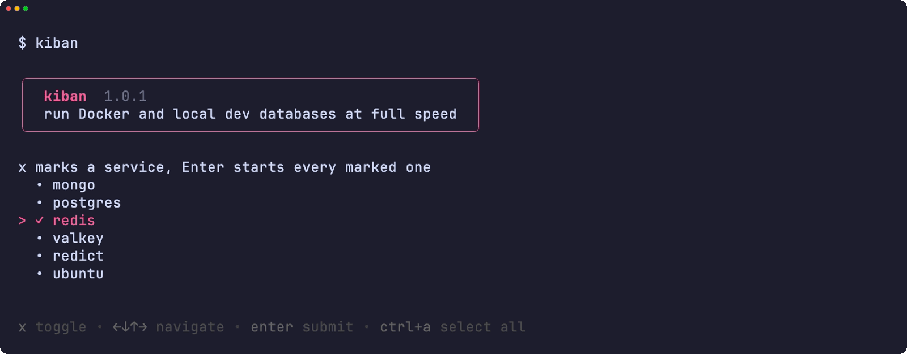<br><sub>標記要啟動的服務</sub></td>
</tr>
<tr>
<td width="50%" valign="top">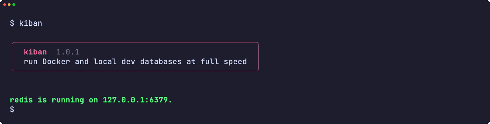<br><sub>已啟動的服務</sub></td>
<td width="50%" valign="top">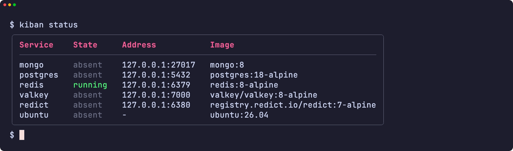<br><sub>每個服務及其地址</sub></td>
</tr>
<tr>
<td width="50%" valign="top">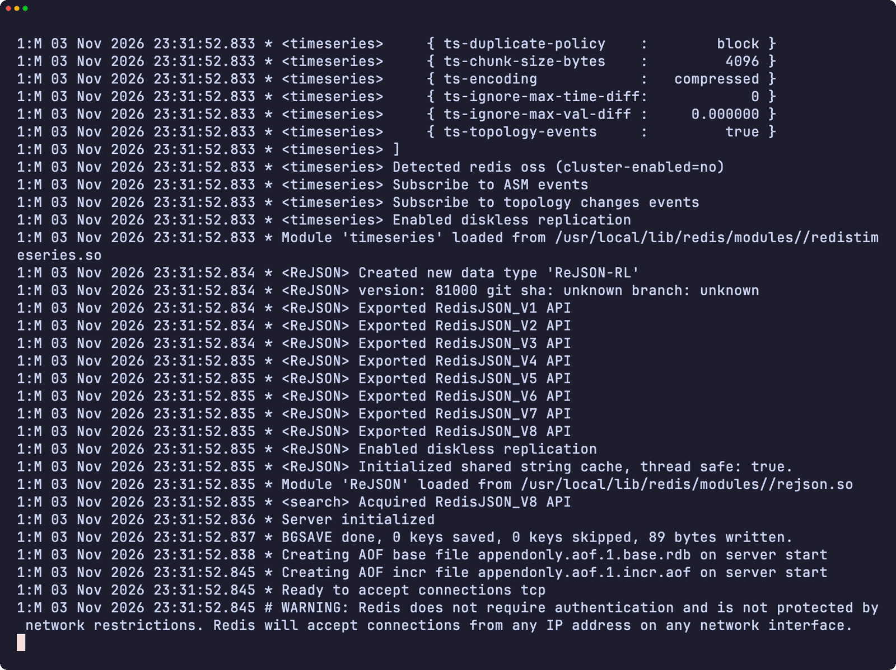<br><sub>容器的日誌</sub></td>
<td width="50%" valign="top">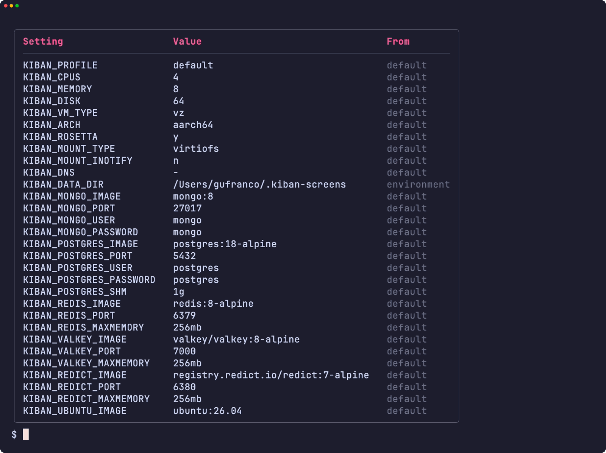<br><sub>每項設定及其來源</sub></td>
</tr>
<tr>
<td width="50%" valign="top">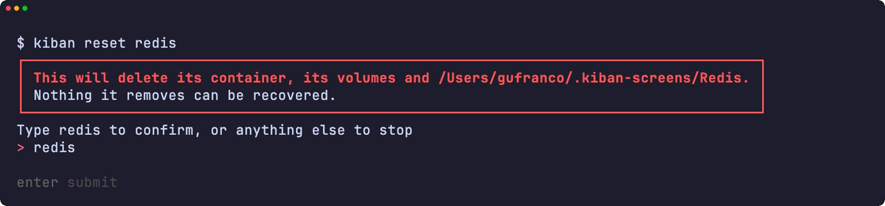<br><sub>危險框下輸入名稱</sub></td>
<td width="50%" valign="top">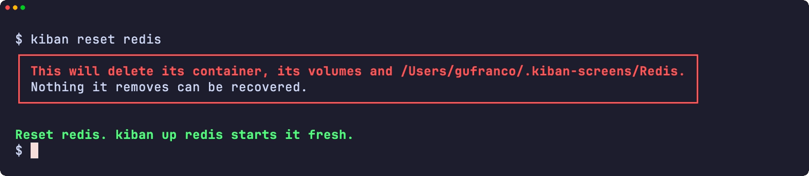<br><sub>已重設的服務</sub></td>
</tr>
<tr>
<td width="50%" valign="top">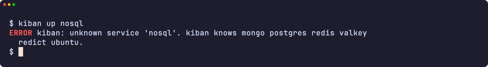<br><sub>錯誤</sub></td>
<td width="50%" valign="top">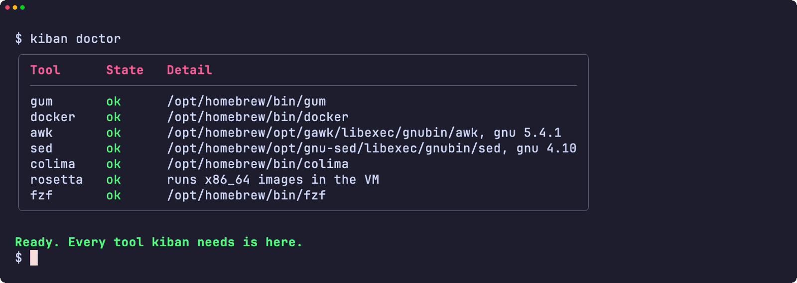<br><sub>doctor 檢查所需的每個工具</sub></td>
</tr>
<tr>
<td width="50%" valign="top">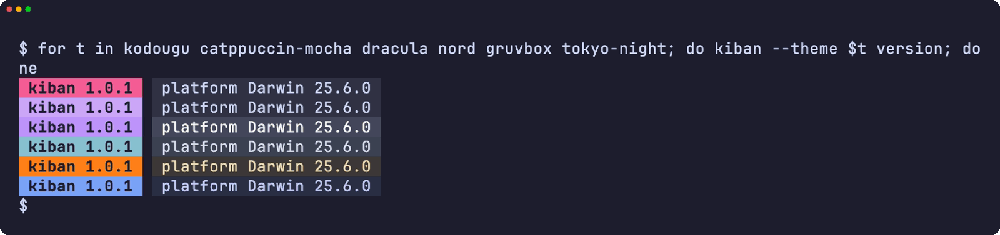<br><sub>六種主題下的版本標記</sub></td>
<td width="50%" valign="top">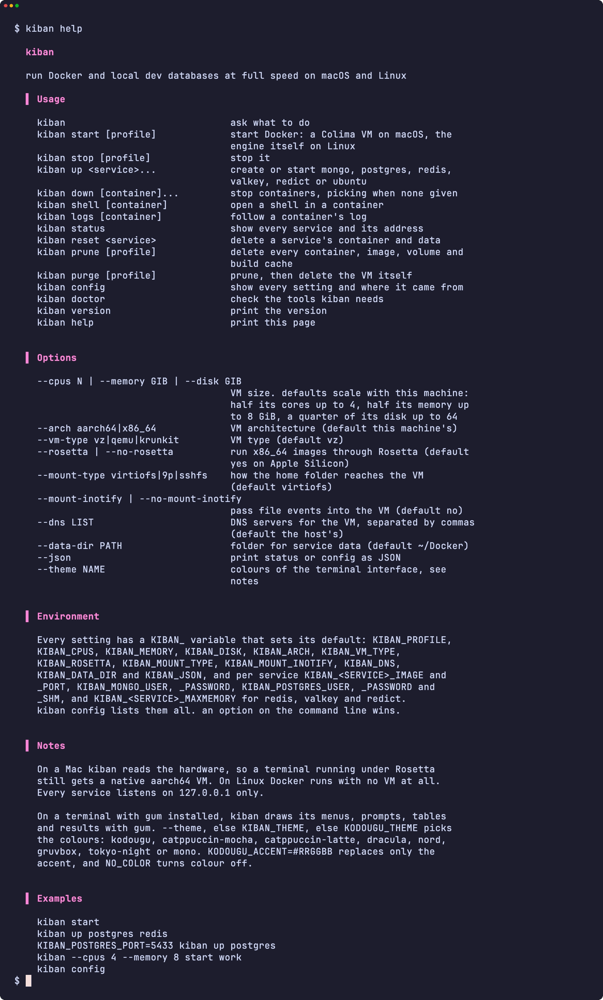<br><sub>說明頁</sub></td>
</tr>
</table>

</details>

<a id="development"></a>

## 開發

| 指令 | 說明 |
|:-----|:-----|
| `make fmt` | 以 shfmt 格式化所有腳本 |
| `make lint` | shfmt、對所有腳本、測試和自動完成執行 ShellCheck、名稱檢查，以及對 man 說明頁執行 mandoc |
| `make test` | 在系統 `sh` 下執行 `bats` 測試 |
| `make test-all` | 在每種 shell 下執行同樣的測試，macOS 上包括 bash 和 zsh 的兩個版本 |
| `make test-linux` | 在 Ubuntu 容器內執行同樣的測試 |
| `make coverage` | 合併本機與 Ubuntu 容器內的 bashcov 行覆蓋率，並執行與 CI 相同的 100% 門檻 |
| `make screens` | 在 macOS 上用 VHS 從真實工具錄製 README 的畫面 |

CI 執行器無法啟動 Colima，所以測試把偽造的 `docker`、`colima`、`systemctl` 和主機工具放在 `PATH` 中，檢查 kiban 的每一次呼叫。推送到 `main` 而 CI 通過後，semantic-release 便會執行：`feat` 或 `fix` 提交會發佈新版本，更新 [`lib/core.sh`](lib/core.sh) 中的 `KIBAN_VERSION` 和 CHANGELOG，並更新 Homebrew formula。

## 授權

[MIT](LICENSE)
