<div align="center">

<h1>kiban</h1>

<strong>以最快速度运行 Docker 和项目所需的本地数据库：在 Mac 上用原生 Colima 虚拟机，在 Linux 上完全不用虚拟机。</strong>

[English](README.md) | [日本語](README.ja.md) | 简体中文 | [繁體中文 (香港)](README.zh-HK.md)

[](https://github.com/gufranco/kiban/actions/workflows/ci.yml)
[](https://github.com/gufranco/kiban/releases/latest)
[](LICENSE)

<p align="center">
  <a href="#quick-start"><strong>快速开始</strong></a> |
  <a href="#settings">设置</a> |
  <a href="#development">开发</a>
</p>

</div>

一个命令，六个服务，每个值都可以用环境变量覆盖。`kiban` 是日语的「基盤」，意思是基础。

---

<p align="center">
  
</p>

```console
$ kiban status
service    state      address           image
mongo      absent     127.0.0.1:27017   mongo:8
postgres   absent     127.0.0.1:5432    postgres:18-alpine
redis      absent     127.0.0.1:6379    redis:8-alpine
valkey     absent     127.0.0.1:7000    valkey/valkey:8-alpine
redict     absent     127.0.0.1:6380    registry.redict.io/redict:7-alpine
ubuntu     absent     -                 ubuntu:26.04
```

<a id="quick-start"></a>

## 快速开始

### 前置条件

| 工具 | 用途 | 安装 |
|:-----|:-----|:-----|
| [`gum`](https://github.com/charmbracelet/gum) | 终端界面：菜单、输入、表格和配色 | `brew install gum`。Homebrew formula 会自动安装 |
| POSIX `sh`、`awk`、`sed` | 工具本身 | macOS 和 Linux 已预装。不需要 `bash` |
| `docker` | Docker CLI | `brew install docker`；Linux 上用 Docker apt 软件源中的 Docker Engine |
| `colima` | Mac 上的虚拟机 | `brew install colima` |
| `systemctl`、`sudo` | 在 Linux 上启动和停止引擎 | Ubuntu 已预装 |
| `fzf` | 可选：在 gum 无法绘制时挑选容器；没有时 kiban 改用编号菜单 | `brew install fzf`；`apt install fzf` |

### 安装

```bash
brew install gufranco/tap/kiban
```

也可以从源码安装：

```bash
git clone https://github.com/gufranco/kiban.git
cd kiban
make install
```

`make install` 会把工具、man 手册以及 bash、zsh 和 fish 的补全复制到 `~/.local`，并把 `kiban` 放进 `~/.local/bin`；设置 `PREFIX` 可以改变位置。Homebrew formula 安装同样的文件。

### 验证

```console
$ kiban doctor
gum                ok       /opt/homebrew/bin/gum
docker             ok       /opt/homebrew/bin/docker
awk                ok       /opt/homebrew/opt/gawk/libexec/gnubin/awk, gnu 5.4.1
sed                ok       /opt/homebrew/opt/gnu-sed/libexec/gnubin/sed, gnu 4.10
colima             ok       /opt/homebrew/bin/colima
rosetta            ok       runs x86_64 images in the VM
fzf                ok       /opt/homebrew/bin/fzf
```

## 用法

| 命令 | 用途 |
|:-----|:-----|
| `kiban start [profile]` | 启动 Docker：Mac 上是 Colima 虚拟机，Linux 上是引擎本身 |
| `kiban stop [profile]` | 停止它 |
| `kiban up <service>...` | 首次创建 mongo、postgres、redis、valkey、redict 或 ubuntu，之后则启动它 |
| `kiban down [container]...` | 停止容器；不指定名称时从运行中的容器里挑选 |
| `kiban shell [container]`、`kiban logs [container]` | 在容器中打开 shell，或跟踪其日志 |
| `kiban status` | 显示每个服务的状态、地址和镜像 |
| `kiban reset <service>` | 删除服务的容器、卷和数据文件夹 |
| `kiban prune [profile]`、`kiban purge [profile]` | 删除所有容器、镜像、卷和构建缓存；`purge` 还会删除虚拟机 |
| `kiban config` | 显示每个设置及其来源 |
| 不带参数的 `kiban` | 在终端中运行时显示菜单：gum 列表，没有 gum 时为编号菜单 |
| `kiban doctor`、`kiban version`、`kiban help` | 检查工具、显示版本、显示用法说明 |

在重新输入服务或配置名称之前，`reset`、`prune` 和 `purge` 不会做任何改动。

```bash
kiban start                          # 按这台 Mac 调整大小的虚拟机
kiban up postgres redis              # 两者，分别在 127.0.0.1:5432 和 :6379
KIBAN_POSTGRES_PORT=5433 kiban up postgres
kiban --cpus 4 --memory 8 start work # 名为 work 的第二台虚拟机
```

kiban 遵循家族共享的命令行约定，内容见 [FAMILY.md](FAMILY.md)。

### 主题

在装有 `gum` 的终端里，kiban 用 gum 绘制菜单、输入、表格和消息；在管道或脚本中，输出仍是纯文本。配色依次由 `--theme`、`KIBAN_THEME`、`KODOUGU_THEME` 决定，最后一个由所有 kodougu 工具共用：`kodougu`（默认）、`catppuccin-mocha`、`catppuccin-latte`、`dracula`、`nord`、`gruvbox`、`tokyo-night` 或 `mono`。`KODOUGU_ACCENT=#RRGGBB` 只替换强调色，`NO_COLOR` 关闭颜色。

```bash
export KODOUGU_THEME=catppuccin-mocha
```

<a id="settings"></a>

## 设置

kiban 使用的每个值都有默认值和对应的 `KIBAN_` 变量；命令行上的选项优先于变量。`kiban config` 列出每个设置、它的值和来源：

```console
$ kiban config
setting                  value                                from
KIBAN_PROFILE            default                              default
KIBAN_CPUS               4                                    default
KIBAN_MEMORY             8                                    default
KIBAN_DISK               64                                   default
KIBAN_VM_TYPE            vz                                   default
KIBAN_ARCH               aarch64                              default
KIBAN_ROSETTA            y                                    default
KIBAN_MOUNT_TYPE         virtiofs                             default
KIBAN_MOUNT_INOTIFY      n                                    default
KIBAN_DNS                -                                    default
KIBAN_DATA_DIR           $HOME/Docker               default
```

| 设置 | 默认值 |
|:-----|:-------|
| `KIBAN_CPUS`、`KIBAN_MEMORY`、`KIBAN_DISK` | 一半的核心，介于 2 到 4；一半的内存，介于 2 到 8 GiB；四分之一的磁盘，介于 8 到 64 GiB |
| `KIBAN_ARCH`、`KIBAN_ROSETTA` | 机器自身的架构；Apple Silicon 上启用 Rosetta |
| `KIBAN_VM_TYPE`、`KIBAN_MOUNT_TYPE`、`KIBAN_MOUNT_INOTIFY` | `vz`、`virtiofs`、`n` |
| `KIBAN_DNS`、`KIBAN_DATA_DIR`、`KIBAN_PROFILE` | 主机的解析器、`~/Docker`、`default` |
| `KIBAN_<SERVICE>_IMAGE` | `mongo:8`、`postgres:18-alpine`、`redis:8-alpine`、`valkey/valkey:8-alpine`、`registry.redict.io/redict:7-alpine`、`ubuntu:26.04` |
| `KIBAN_<SERVICE>_PORT` | mongo 27017、postgres 5432、redis 6379、valkey 7000、redict 6380 |
| `KIBAN_MONGO_USER`、`KIBAN_MONGO_PASSWORD`、`KIBAN_POSTGRES_USER`、`KIBAN_POSTGRES_PASSWORD` | `mongo`、`mongo`、`postgres`、`postgres` |
| `KIBAN_THEME`、`--theme` | `KODOUGU_THEME`，否则 `kodougu`；见主题一节 |
| `KIBAN_POSTGRES_SHM`、`KIBAN_<SERVICE>_MAXMEMORY` | `1g`；redis、valkey 和 redict 为 `256mb` |

<a id="speed"></a>

## 速度

| 机器 | kiban 的做法 |
|:-----|:-------------|
| Mac，Apple Silicon | 基于 Apple Virtualization 框架和 virtiofs 的原生 aarch64 虚拟机，x86_64 镜像通过 Rosetta 运行。它读取硬件信息，因此即使终端运行在 Rosetta 下，仍然得到原生虚拟机 |
| Mac，Intel | 基于同一框架和 virtiofs 的 x86_64 虚拟机 |
| Linux，x86_64 或 arm64 | 没有虚拟机：Docker 直接在本机运行 |

所有默认镜像都有 amd64 和 arm64 版本，因此在上述每种机器上服务都无需模拟。除非用 `--mount-inotify` 要求，文件事件不会传入虚拟机，因为转发主目录中的每次变化都会消耗 CPU。postgres 获得 1 GiB 共享内存，而不是 Docker 默认的 64 MiB，后者会限制并行查询。kiban 本身解析所有设置时不启动额外进程，所以 `kiban config` 约十分之一秒就能给出结果。

<a id="portability"></a>

## 可移植性

全部使用 POSIX `sh` 编写，ShellCheck `-o all` 零警告。测试在 macOS 上于 `/bin/sh` 和 `dash`、系统自带的 bash 3.2 和 zsh、Homebrew 最新的 bash 和 zsh 下运行，在 Ubuntu 上于容器中的 `dash`、`bash`、`bash --posix` 和 `zsh` 下运行。CI 会在家族的六种工具集上重复这些测试，`kiban doctor` 会写出 `awk` 和 `sed` 的种类与版本。

<a id="screens"></a>

## 界面

<details>
<summary>全部界面，均由 <code>make screens</code> 录自真实运行</summary>
<br>

<table>
<tr>
<td width="50%" valign="top">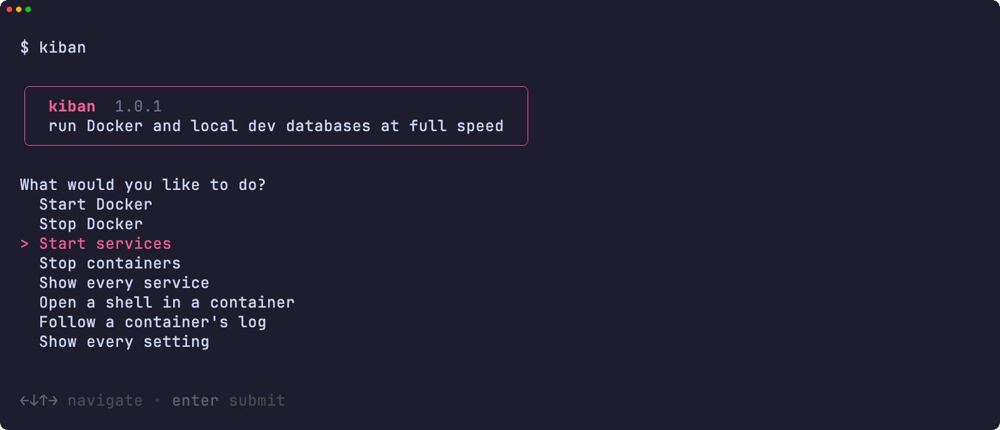<br><sub>菜单</sub></td>
<td width="50%" valign="top">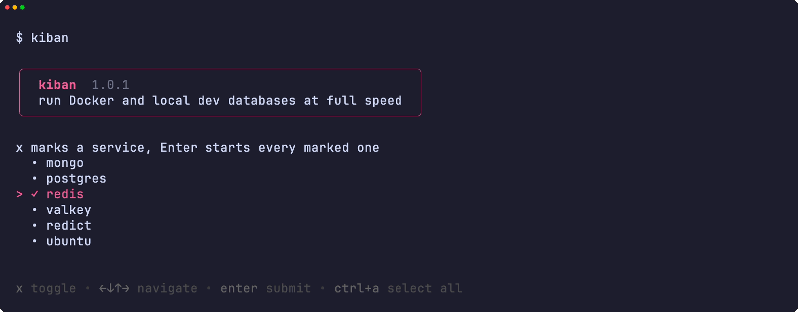<br><sub>标记要启动的服务</sub></td>
</tr>
<tr>
<td width="50%" valign="top">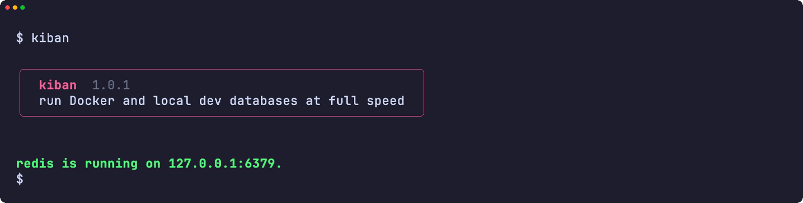<br><sub>已启动的服务</sub></td>
<td width="50%" valign="top">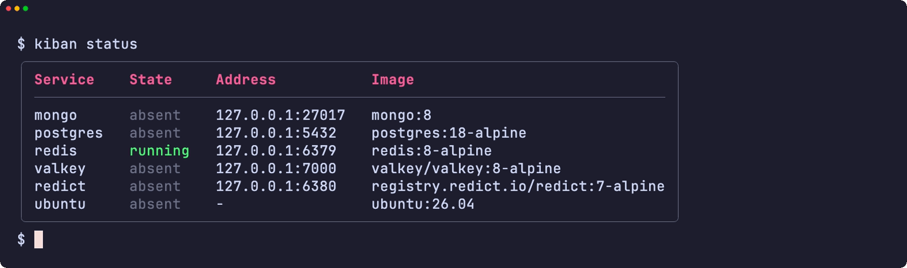<br><sub>每个服务及其地址</sub></td>
</tr>
<tr>
<td width="50%" valign="top">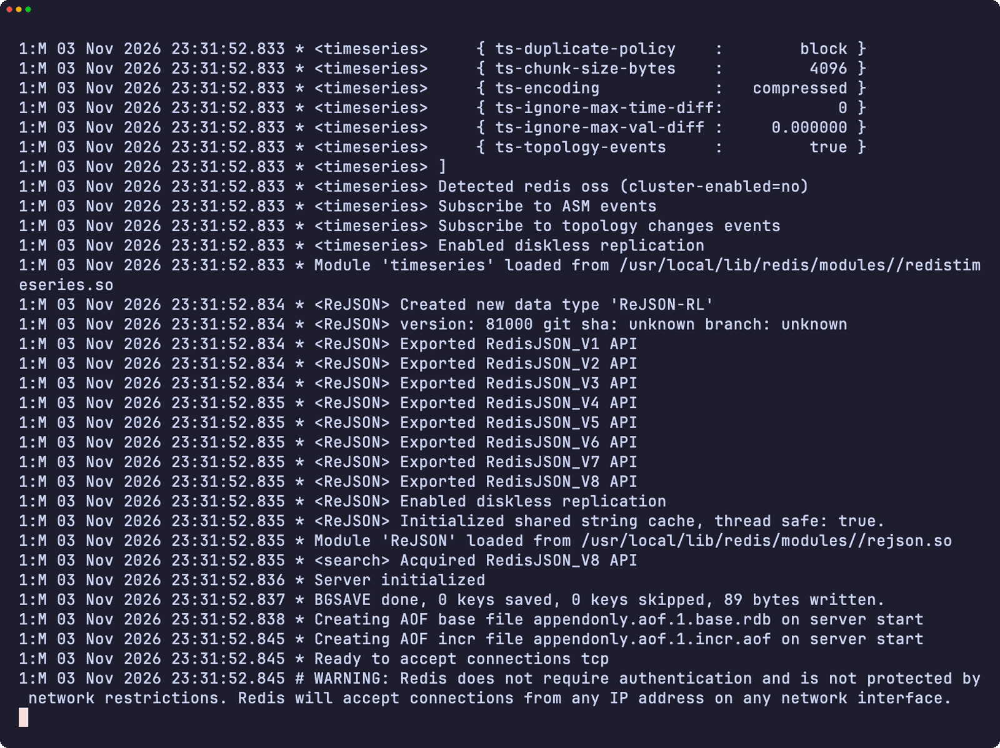<br><sub>容器的日志</sub></td>
<td width="50%" valign="top">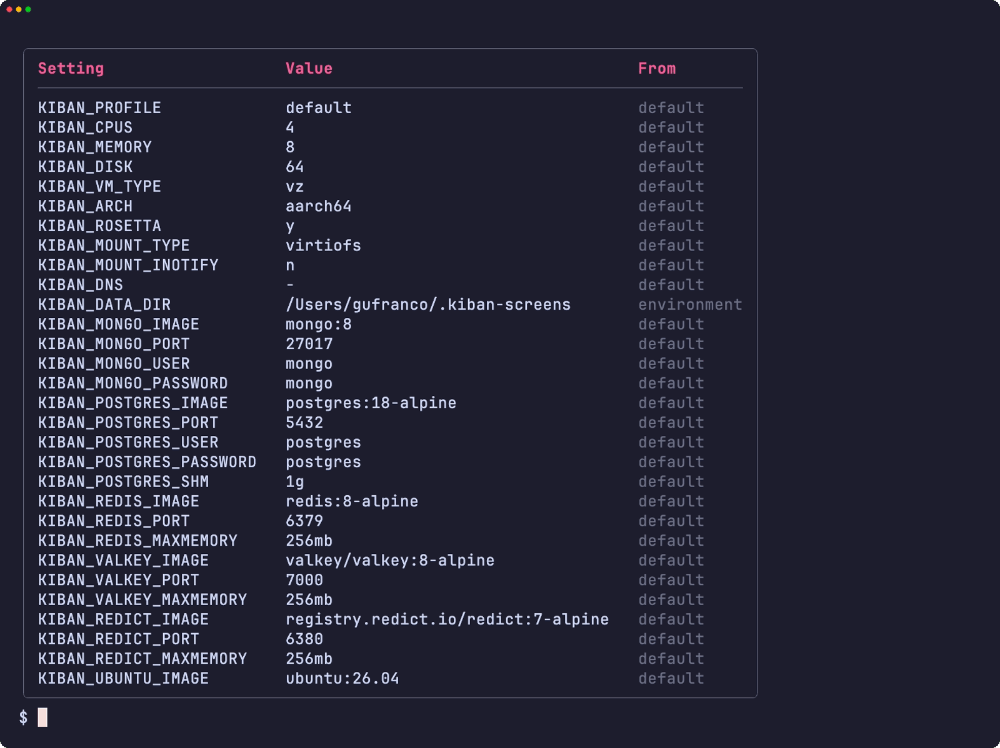<br><sub>每项设置及其来源</sub></td>
</tr>
<tr>
<td width="50%" valign="top">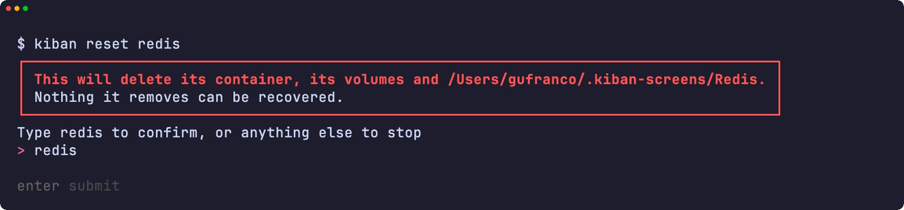<br><sub>危险框下输入名称</sub></td>
<td width="50%" valign="top">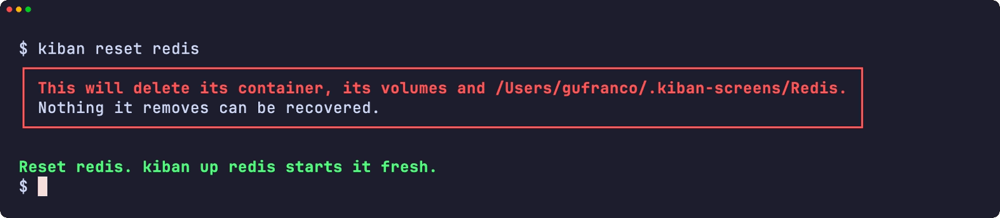<br><sub>已重置的服务</sub></td>
</tr>
<tr>
<td width="50%" valign="top">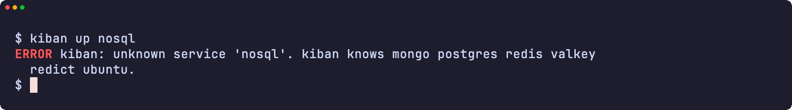<br><sub>错误</sub></td>
<td width="50%" valign="top">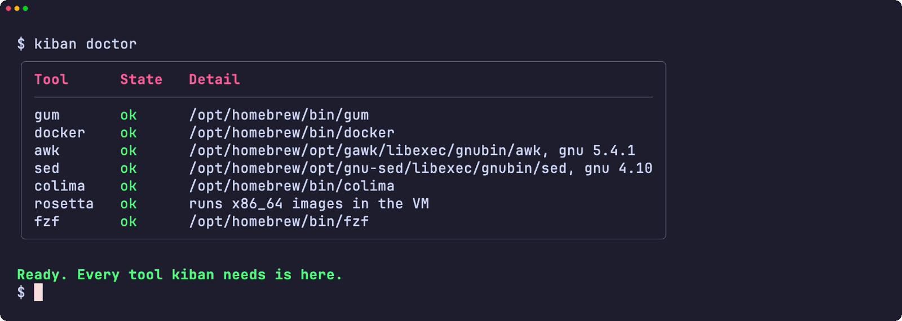<br><sub>doctor 检查所需的每个工具</sub></td>
</tr>
<tr>
<td width="50%" valign="top">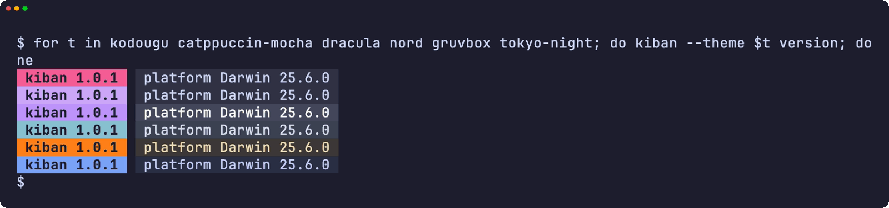<br><sub>六种主题下的版本标记</sub></td>
<td width="50%" valign="top">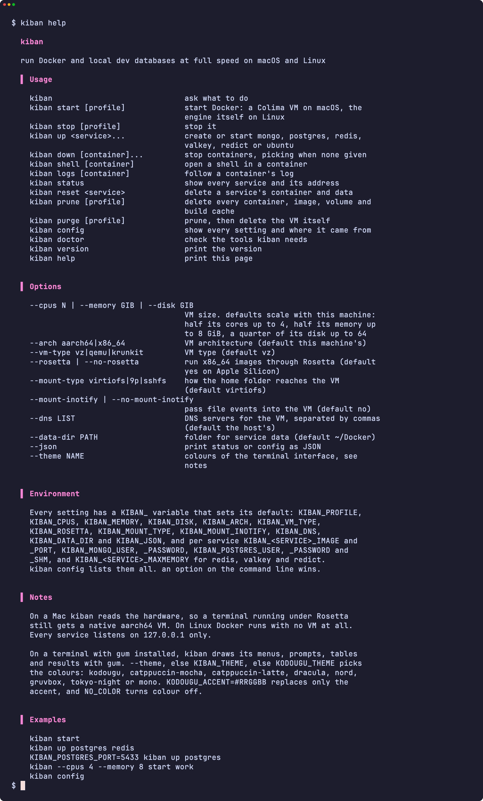<br><sub>帮助页</sub></td>
</tr>
</table>

</details>

<a id="development"></a>

## 开发

| 命令 | 说明 |
|:-----|:-----|
| `make fmt` | 用 shfmt 格式化所有脚本 |
| `make lint` | shfmt、对所有脚本、测试和补全运行 ShellCheck、名称检查，以及对 man 手册运行 mandoc |
| `make test` | 在系统 `sh` 下运行 `bats` 测试 |
| `make test-all` | 在每种 shell 下运行同样的测试，macOS 上包括 bash 和 zsh 的两个版本 |
| `make test-linux` | 在 Ubuntu 容器中运行同样的测试 |
| `make coverage` | 合并本机与 Ubuntu 容器中的 bashcov 行覆盖率，并执行与 CI 相同的 100% 门槛 |
| `make screens` | 在 macOS 上用 VHS 从真实工具录制 README 的界面 |

CI 运行器无法启动 Colima，因此测试把伪造的 `docker`、`colima`、`systemctl` 和主机工具放在 `PATH` 中，检查 kiban 的每一次调用。推送到 `main` 且 CI 通过后，semantic-release 会运行：`feat` 或 `fix` 提交会发布新版本，更新 [`lib/core.sh`](lib/core.sh) 中的 `KIBAN_VERSION` 和 CHANGELOG，并更新 Homebrew formula。

## 许可证

[MIT](LICENSE)
